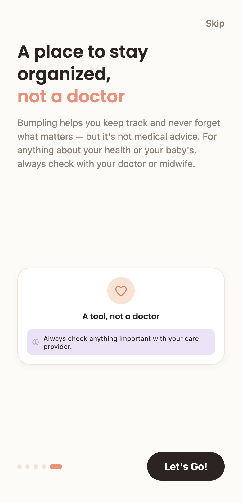
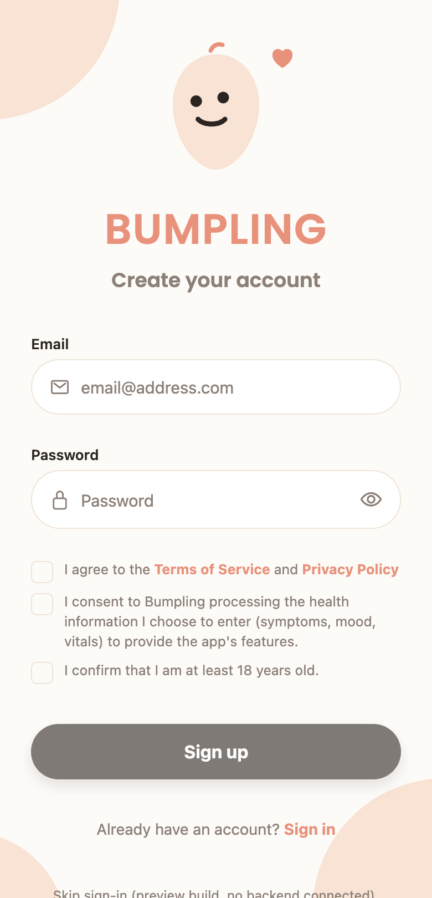
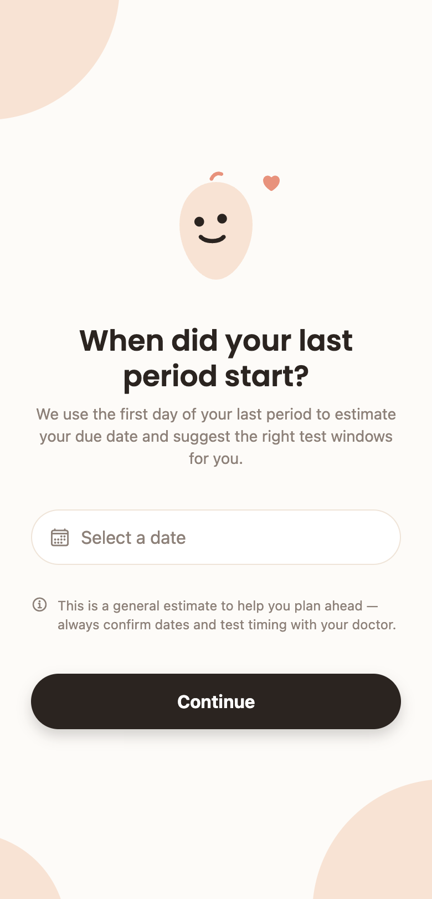
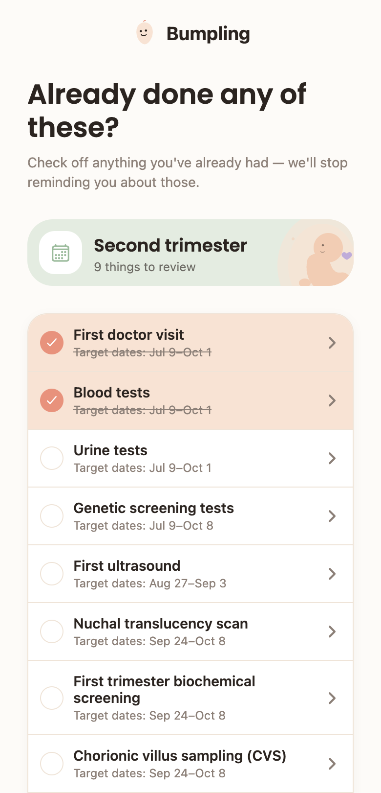
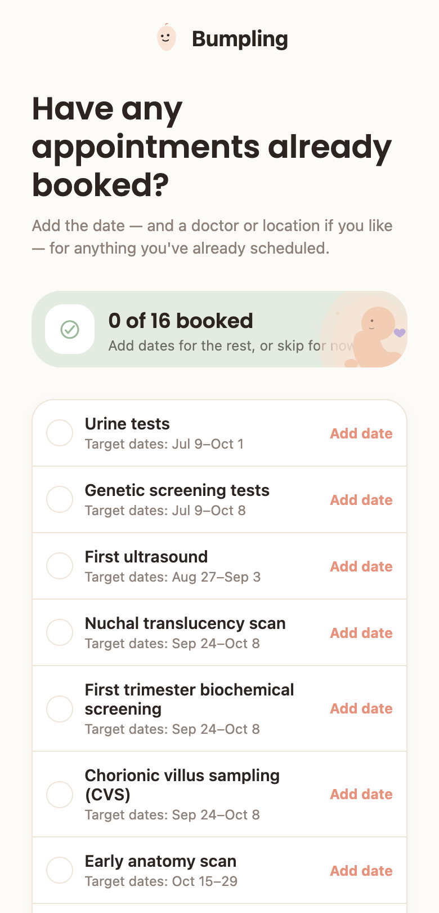
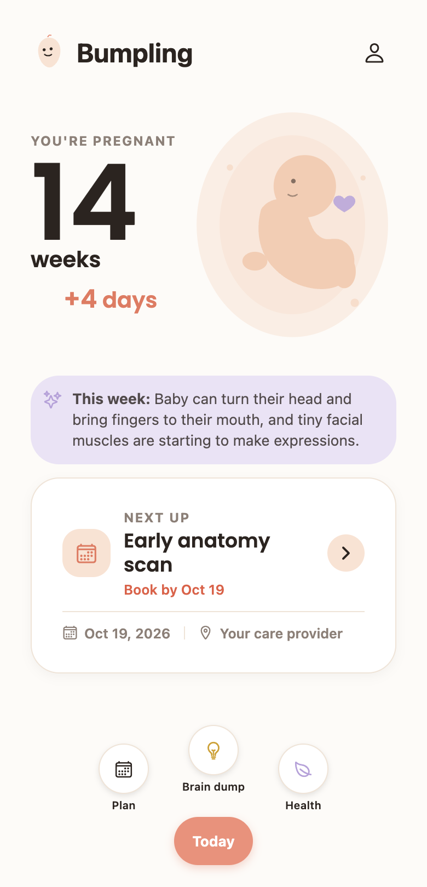
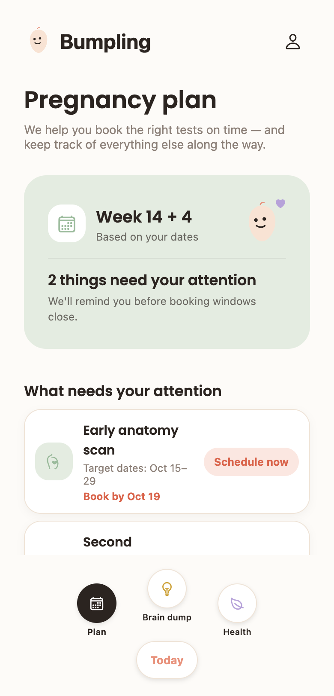
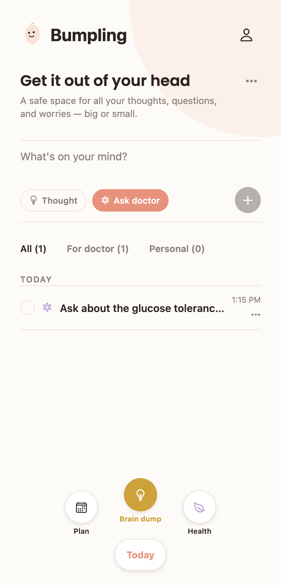
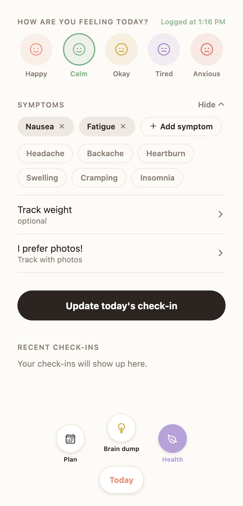

# Bumpling

A calm, all-in-one pregnancy companion: a personal, deadline-aware care plan (tests, scans, appointments — mapped to your own trimester, not a generic timeline), plus day-to-day mood/symptom logging, free-form "brain dump" notes, and a guided flow for a shareable birth plan.

**[Try the live web preview →](https://noyelankry.github.io/bumpling/)**

No backend is wired up on the preview build — a banner marks it as such, and a "skip sign-in" button lets you explore the full app without an account. Nothing you enter there is saved anywhere.

## A visual tour

Every screenshot below is a real screen from the app (captured from the live preview above), not a mockup.

### Onboarding & account

<table>
<tr>
<td width="33%"></td>
<td width="33%"></td>
<td width="33%"></td>
</tr>
<tr>
<td>A 5-slide carousel introduces Plan, Today, Health, and the all-in-one pitch before account creation.</td>
<td>The carousel's last slide is a medical disclaimer — reinforced again on the next screen.</td>
<td>Sign-up gates on three separate consents: terms &amp; privacy, health-data processing, and an 18+ age attestation.</td>
</tr>
</table>

### Setting up your care plan

<table>
<tr>
<td width="33%"></td>
<td width="33%"></td>
<td width="33%"></td>
</tr>
<tr>
<td>Your last-period date is all it takes to compute gestational age and the right test/scan windows.</td>
<td>Already had some of these? Check them off once and Bumpling stops reminding you.</td>
<td>Already got appointments on the calendar? Add the dates now so Plan starts accurate.</td>
</tr>
</table>

### Daily use

<table>
<tr>
<td width="25%"></td>
<td width="25%"></td>
<td width="25%"></td>
<td width="25%"></td>
</tr>
<tr>
<td><b>Today</b> — current week, this week's development fact, and what needs attention next.</td>
<td><b>Plan</b> — the full trimester-by-trimester care-item list, with booking deadlines.</td>
<td><b>Brain dump</b> — a free-form note space, filterable by "for doctor" vs. personal.</td>
<td><b>Health</b> — a daily mood/symptom/vitals check-in with a running history.</td>
</tr>
</table>

Beyond these four tabs, the app also covers: appointment detail + visit notes + partner share-out, a "Prepare for birth" guided flow that produces a shareable PDF birth plan, a Profile screen (partner contact, language switch between English/Hebrew with full RTL, change password, delete account, data export), and legal pages. See [PRODUCT.md](PRODUCT.md) for the full product spec.

## Tech stack

- [Expo](https://expo.dev) + [expo-router](https://docs.expo.dev/router/introduction/) (React Native, targeting iOS — see [PRODUCT.md](PRODUCT.md))
- [Supabase](https://supabase.com) for auth (data layer is mid-migration from on-device storage — see [BACKEND.md](BACKEND.md))
- [react-i18next](https://react.i18next.com) for English/Hebrew localization with RTL layout

## Setup & run locally

1. Install dependencies:
   ```bash
   npm install
   ```
2. Create a [Supabase](https://supabase.com/dashboard) project, then copy its URL and publishable (anon) key into a `.env` file:
   ```bash
   cp .env.example .env
   ```
   ```
   EXPO_PUBLIC_SUPABASE_URL=...
   EXPO_PUBLIC_SUPABASE_PUBLISHABLE_KEY=...
   ```
3. Run the app:
   ```bash
   npm start      # dev client
   npm run ios    # native iOS build
   npm run web    # web, in a browser
   ```

The Supabase schema this app expects is not yet live anywhere — see [BACKEND.md](BACKEND.md) for the full migration plan from the current on-device storage.
